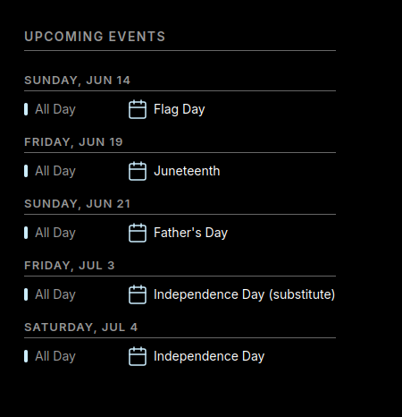
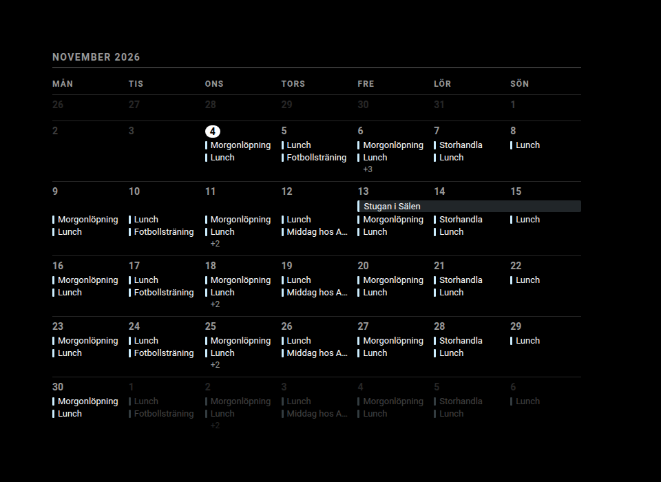

# mirrordash-calendar

Detailed calendar module showing upcoming events for MirrorDash.

## Features
- Supports standard iCalendar (`.ics`) subscriptions from Google Calendar, Apple iCloud, Microsoft Outlook, etc.
- Async parallel fetching of multiple calendars with caching.
- Dynamic color swatches and customizable vector icons for events.
- Three views (the **View** setting): **List**, the next events day by day; **Week**, this week Monday to Sunday with times; **Month**, this month as a grid with events over several days as bars and "+N" when a day is full. Want two views? Add the module twice.

## Installation

On the mirror's admin page, open **Modules**: the module is in the list, install it with one click.
Or paste `git+https://github.com/Menturan/mirrordash-calendar.git` under **Modules → Add modules → Install from a Git URL or folder**.

Developing it: `uv run pytest` runs its tests, and `uvx mirrordash-sdk validate .` checks it.

## Screenshot

The month view:

## Troubleshooting

### Calendar events are not showing up
*   Verify that your calendar URL is public and ends with `.ics`. 
*   Google Calendar private links must be the "Secret address in iCal format" found in your Google Calendar settings.

## License
[MIT](LICENSE)
